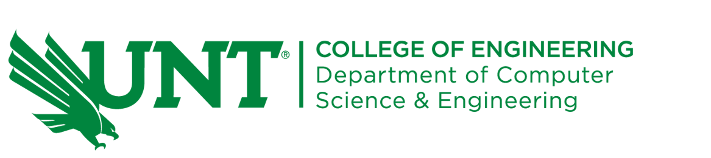

  <strong>Ph.D. Candidate</strong>
  

I am a Ph.D. candidate in Computer Science and Engineering at the University of North Texas. I conduct research in the Active Machine Learning (AML) Lab and the [Learning, Language, Vision (LLaVi) Lab](https://llavi-lab.github.io/) under the supervision of Dr. Weishi Shi. I completed my Master's degree in Computer Science from the Department of Computer Science and Engineering at the University of North Texas with a 4.00 GPA.

My research focuses on **deep active learning**, **continual lifelong learning**, and **multimodal learning**, with the goal of making AI systems more adaptive, robust, and useful in real-world settings.

  <strong>Actively seeking opportunities</strong> 
  I am actively looking for Applied Scientist, Research Scientist, Postdoctoral, and Assistant Professor positions.

[LinkedIn](https://www.linkedin.com/in/alforhad) · [GitHub](https://github.com/alforhad) · [Google Scholar](https://scholar.google.com/citations?user=AljTQdQAAAAJ&hl=en)

<h2><a href="/news/" style="color: inherit;">news</a></h2>



[See all news →](/news/)

<h2><a href="/publications/" style="color: inherit;">selected publications</a></h2>



[See all publications →](/publications/)
